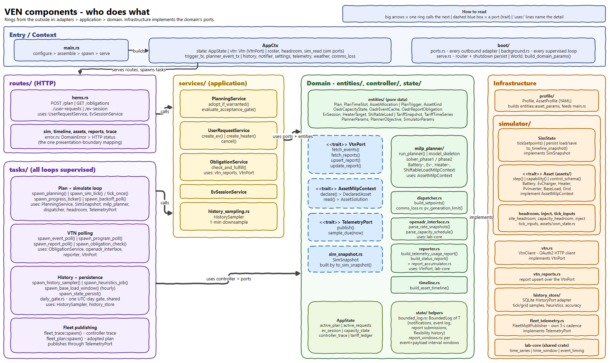

# Meet the VEN: a guided tour of the component diagram

Editable source: [`module_component_diagram.drawio`](module_component_diagram.drawio). Next stop after
this page: [module_import_graph.md](module_import_graph.md), the same crate seen through its imports.

If the picture looks like a lot, that is fine. This page walks through it in the order a newcomer
needs it: first the problem, then the jobs, then the picture one area at a time.

## 1. The problem, in a house

Picture a house with solar panels, a battery, an electric car, a hot-water heater and everything else
that plugs in. Two things pull on it at once.

* **The grid** sometimes needs help. Electricity is cheap at noon and expensive at six in the evening,
  and when the network is stressed the grid operator asks houses to draw less, or draw more, for a
  while.
* **The people** have wishes. The car must be full by seven tomorrow. The water must be hot for the
  evening shower.

Somebody has to reconcile the two, every second, without the residents thinking about it. In this
project that somebody is the **VEN**, the Virtual End Node: a program that lives in the house. The
operator's side is the **VTN**, the Virtual Top Node, and the two talk in a standard language called
**OpenADR 3**. The VTN says "here are the prices and limits"; the VEN works out what each device
should do about it and says back "here is what I used".

## 2. What the VEN actually does

Strip away the details and the VEN has four jobs. Every box in the picture serves one of them.

| Job | In plain words | Where you find it in the picture |
|---|---|---|
| **Listen** | Hear what the grid wants and what the user wants. | VTN polling loops, HTTP routes, MQTT feeds |
| **Decide** | Turn wishes and constraints into a plan: when should each device run? | The planner (a mixed-integer optimisation), the services around it |
| **Act** | Every second, set each device to the power the plan says. | The dispatcher and the simulated or real assets |
| **Tell** | Report back to the VTN, keep a history, show everything on a dashboard. | Reports, history store, fleet publisher |

You will see the VEN described with two speeds: a **slow loop** that *plans* (about every five minutes,
and immediately when something important changes) and a **fast loop** that *acts* (every second). The
slow one thinks; the fast one executes.

## 3. Why not one big program?

You could write all of that in one file. It would work, until the day you wanted to:

* swap the simulated battery for a real one,
* test the planner without a VTN, a clock or a database,
* change the optimiser without breaking the web API,
* or find out why one device behaves oddly.

So the VEN is built like a well-run restaurant. There is a **front door** where requests arrive (the
waiters), a **kitchen with rules** that decides what gets cooked (the chefs), and **suppliers and
appliances** that do the physical work. The chefs do not care whether the oven is gas or electric; they
only know "an oven takes this instruction". In software terms this is called a hexagonal or
ring architecture, and it has one law:

> **Inner rings never depend on outer rings.** The decisions are made in the middle and know nothing
> about the outside world. The outside world plugs into the middle through small, named sockets
> called **ports**.

That one law is why the picture is arranged in columns and why there are so many boxes: each box has
one job and sits in exactly one ring.

## 4. Walking the picture

Read it from the left, from the outside in, with the banner on top as the starting point.

### The banner: switching the VEN on (Entry / Context)

`main.rs` does four things in order: configure, assemble, spawn, serve. The `boot/` folder is where the
assembling happens: it builds every outside connection and starts every background loop. `AppCtx` is
the tool belt handed to the web handlers; each handler picks only the pockets it needs.
*Why separate:* putting construction in one place means everything else receives what it needs and can be
built in a test without the real world.

### Column 1, the front door (Adapters)

* **`routes/`** is the HTTP side: the user interface asks for a plan, an EV session or a report here.
  One place, `error.rs`, turns an internal error into an HTTP answer.
* **`tasks/`** is every clock-driven loop: poll the VTN, plan, simulate a second, save state, sample
  history, publish to the fleet dashboard. Each runs under `supervised_spawn()`, which restarts a loop
  that dies. The loops decide *when* things happen and call the rest to decide *what*.

### Column 2, the use cases (Application)

`services/` holds one service per thing a user or the grid can ask for: adopt a plan, create an EV or
heater request, fulfil a report obligation, track an EV session, downsample history. A route and a task
can share a service instead of each doing their own version.

### Column 3, the brain (Domain)

This is the part that would still be correct if you replaced every other column.

* **`entities/`** is plain data: a plan, a time slot, a request, a tariff.
* **Ports** (the dashed blue boxes) are the sockets. `VtnPort` is "something that fetches events and
  accepts reports". `AssetMilpContext` is "something that can tell the planner what it can do".
  `TelemetryPort` is "somewhere to publish to". `SimSnapshot` is "a read-only photo of the devices".
* **`controller/`** is the logic: the **planner**, the **dispatcher** that turns a plan slot into device
  setpoints, the OpenADR interface that reads prices and limits out of events, the reporter, a
  timeline builder for the UI, and what to do if the VTN cannot be reached.
* **`state/`** is the VEN's working memory: the active plan, active requests, the capacity limits in
  force, a short trace of recent decisions.

### Column 4, the real world (Infrastructure)

Here the ports meet reality. `simulator/` runs physics models of the battery, EV charger, heater, PV
inverter, base load and grid meter; `vtn.rs` is the OAuth2 HTTP client; `history_store/` is a small
SQLite database; `fleet_telemetry.rs` publishes live state on the lab's message broker; `profile/`
reads the per-VEN YAML that says which devices exist; `lab-core` is a small library shared with the VTN.
Each of these *implements* a port: that is the dashed arrow back into the brain.

Notice what is missing from the brain: it never names a battery or an EV. Each device *declares* what it
can do, and the planner uses that. Adding a new kind of device is a change on the right-hand side.

## 5. A day in the life

* **The grid asks for less power.** A polling loop fetches the event; the OpenADR interface turns it
  into a capacity limit; that triggers a new plan. Each device says what it can do, the planner finds the
  cheapest way to respect the limit, and the plan is adopted if it is good enough. From then on the
  dispatcher sets the devices every second, and the reporter sends back what actually happened.
* **A user plugs in the car.** The web UI posts a request; `routes/` hands it to a service; the service
  stores it and triggers a new plan, which now includes "full by seven".
* **A dashboard watches the fleet.** The tick, trace and plan loops publish through `TelemetryPort`, and
  the fleet publisher puts them on the broker. Nothing in the brain knows a broker exists.

## 6. So why so many boxes?

* **Things change at different speeds.** A new web route, a better optimiser term and a new battery
  model change for different reasons. One box per reason keeps each edit small.
* **Everything can be tested alone.** Every port has a stand-in, so a planner or a service runs in a
  test with no VTN, no database and no real clock.
* **Each rule lives in one place.** "Which limit applies right now" or "what can this device do" has a
  single owner that everyone asks, so there is no second copy to get out of step.
* **A device speaks for itself.** The planner, dispatcher and UI ask a device what it can do, rather than
  guessing from raw numbers.
* **The edges can be swapped.** The same brain runs against simulated or real devices and against a mock
  VTN, because only the outer column knows which is which.
* **It keeps working when something breaks.** Loops are supervised and slow work such as history stays
  off the control path, so a stuck database cannot stop the heater.

## 7. Where to go next

* [module_import_graph.md](module_import_graph.md): the same code seen through its imports, and how the
  two pictures differ.
* [VEN_ARCHITECTURE.md](VEN_ARCHITECTURE.md): the full reference: planning algorithm, assets, API.
* `.claude/CLAUDE.md` (`ven-architecture`): the ring rule and the audits that enforce it.
