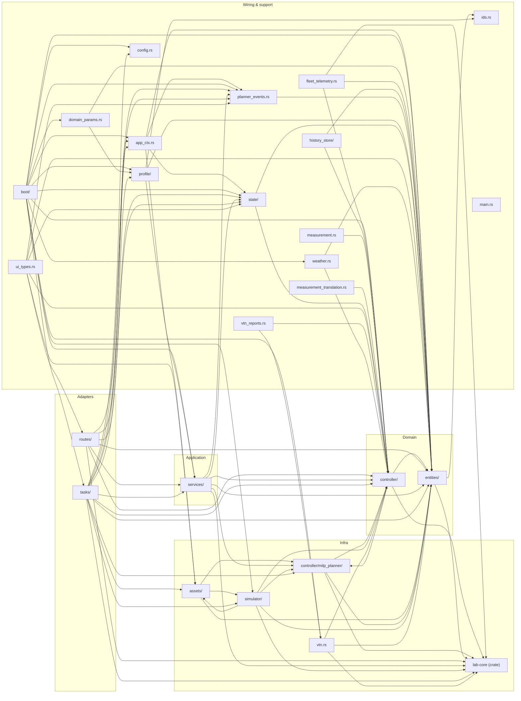

# VEN module dependency graph

Two views of `VEN/src`. The component diagram is drawn by hand: it names the parts and what they do,
and `scripts/audit_module_graph.py` checks that every edge resolves and that every `tasks/` loop and
top-level directory appears in it. The import graph below it is generated from the code
(`python scripts/gen_module_graph.py`; `--check` fails when it is stale), so it is the authority on
which module imports which. The ring rules themselves are enforced by
`ci/audits/audit_ven_architecture.py`.

## Component diagram (hand-drawn)

```mermaid
graph TB
      subgraph ADAPTERS["🔌 Adapters Layer"]
          direction LR
          subgraph ROUTES["routes/"]
              R_ROUTER["build_router()"]
              R_HEMS["hems.rs\nPOST /plan\nGET /obligations\n/user-requests\n/ev-session"]
              R_SIM["sim.rs\nGET/POST /sim\n/sim/inject\n/sim/schema"]
              R_TL["timeline.rs\nGET /timeline/all\n/timeline/:asset_id"]
              R_ASSETS["assets.rs\nGET /capability/:id"]
              R_REPORTS["reports.rs\nGET/POST /reports"]
              R_TRACE["trace.rs\nGET /trace/events"]
              R_ERR["error.rs\nDomainError → HTTP status\n(the one presentation-boundary mapping)"]
          end
          subgraph TASKS["tasks/"]
              T_SIMTICK["spawn_sim_tick()\ntick_once()"]
              T_PLANNING["spawn_planning()"]
              T_EVENTS["spawn_event_poll()"]
              T_REPORTS["spawn_report_poll()"]
              T_OBLIG["spawn_obligation_check()"]
              T_PERSIST["spawn_state_persist()"]
              T_PROGRAMS["spawn_program_poll()"]
              T_HISTORY["spawn_history_sampler()"]
              T_HEURISTICS["spawn_heuristics_job()"]
              T_BACKOFF["spawn_backoff_poll()"]
              T_PROGRESS["spawn_progress_ticker()"]
              T_FLEETTRACE["fleet_trace::spawn()\npublishes controller trace"]
              T_FLEETPLAN["fleet_plan::spawn()\npublishes the adopted plan"]
              T_SUPERVISE["supervised_spawn()\nrestarts any loop that dies"]
              T_BASELOAD["spawn_base_load_window()\nhourly base-load window\nfrom HistoryPort"]
              T_DAILY["daily_gate.rs\nDailyGate — one UTC-day gate,\nshared by history_sampler + heuristics_job"]
          end
      end

      subgraph APP["⚙️  Application Layer — services/"]
          SVC_PLAN["PlanningService\nadopt_if_warranted()\nevaluate_acceptance_gate()"]
          SVC_UREQ["UserRequestService\ncreate_ev()\ncreate_heater()\ncancel()"]
          SVC_OBLIG["ObligationService\ncheck_and_fulfill()"]
          SVC_HEMS["EvSessionService"]
          SVC_HSAMP["history_sampling.rs\nHistorySampler — 1-min downsample\n(was tasks/history_sampler/accumulator.rs)"]
      end

      subgraph DOMAIN["🎯 Domain / Controller"]
          direction TB
          subgraph ENTITIES["entities/"]
              E_PLAN["Plan\nPlanTimeSlot\nAssetAllocation"]
              E_ASSET["PlanTrigger\nAssetKind\nPowerAdjustability"]
              E_CAP["OadrCapacityState\nOadrEventCache\nOadrReportObligation"]
              E_SESSION["EvSession\nHeaterTarget\nShiftableLoad"]
              E_TARIFF["TariffSnapshot\nTariffTimeSeries"]
              E_PARAMS["PlannerParams\nPlannerObjective\nSimulatorParams"]
          end
          subgraph CTRL["controller/"]
              C_PORT_SIM["sim_snapshot.rs\nSimSnapshot\n(SimState::to_sim_snapshot)"]
              C_PORT_VTN["≪trait≫\nVtnPort\nfetch_events()\nfetch_reports()\nupsert_report()\nupdate_report()"]
              C_PORT_MILP["≪trait≫\nAssetMilpContext\ndeclare() → DeclaredAsset\nread() → AssetSolution"]
              C_DISPATCH["dispatcher.rs\nbuild_setpoints()"]
              C_COMMSLOSS["comms_loss.rs\nCommsLossState\npv_generation_limit()"]
              C_OAADR["openadr_interface.rs\nparse_rate_snapshots()\nparse_capacity_schedule()"]
              C_PORT_TELEM["≪trait≫\nTelemetryPort\npublish()\nsample_due(now)"]
              C_ACCUM["report_accumulator.rs\nappend + bounded trim"]
              C_REPORTER["reporter.rs\nbuild_telemetry_usage_report()\nbuild_status_report()"]
              C_TIMELINE["timeline.rs\nbuild_asset_timeline()"]
              C_MILP["milp_planner/\nrun_planner()\nmodel_skeleton\nsolver_phase1\nsolver_phase2\nBatteryMilpContext\nEvMilpContext\nHeat
          end
          RPTWIN["state/report_windows.rs\nper-(event,payload) interval windows"]
          BLOG["state/bounded_log.rs\nBoundedLog&lt;T&gt; — notifications,\nevent log, report submissions,\nflexibility history"]
          STATE["AppState\nactive_plan\nactive_requests\nev_session\ncapacity_state\ncontroller_trace\ntariff_ledger"]
      end

      subgraph INFRA["🏗️  Infrastructure"]
          direction LR
          subgraph SIM["simulator/"]
              SIM_STATE["SimState\ntick(setpoints)\nto_sim_snapshot()\nto_timeline_snapshot()\npersist load/save"]
              ASSETS_MOD["≪trait≫ Asset\nstep()\ncapability()\ncontrol_schema()"]
              A_BAT["Battery\nBatteryState"]
              A_EV["EvCharger\nEvState"]
              A_HTR["Heater\nHeaterState"]
              A_PV["PvInverter\nPvState"]
              A_BASE["BaseLoad\nBaseLoadState"]
              A_GRID["Grid\nGridState"]
              SIM_HEADROOM["site_headroom.rs\ncapacity_headroom.rs\ntake &SimState, so infra not domain"]
              SIM_INJECT["inject.rs\napply_state_injections()"]
              SIM_TICKIN["tick_inputs.rs\nTickInputs — one named\nobject for tick's 25 inputs"]
              OWNSTATE["assets/own_state.rs\nown::&lt;S&gt;(state)\nthe config/state pairing,\ndeclared once, checked once"]
          end
          VTN_CLIENT["vtn.rs\nVtnClient\nOAuth2 HTTP client"]
          PROFILE["profile/\nProfile · AssetProfile (YAML)\nbuilds entities::asset_params"]
          HSTORE["history_store/\nSQLite HistoryPort adapter\ntick/grid samples, heuristics,\nforecast accuracy"]
          FLEET_PUB["fleet_telemetry.rs\nFleetMqttPublisher\nown 5 s cadence (D-1)"]
          VTN_REPORTS["vtn_reports.rs\nreport upsert over the VtnPort"]
          LABCORE["lab-core (shared crate)\ntime_series\ntime_window\nevent_timing"]
      end

      subgraph ENTRY["🚀 Entry / Context"]
          MAIN["main.rs\nconfigure · assemble · spawn · serve"]
          BOOT["boot/\nports.rs — every outbound adapter\nbackground.rs — every supervised loop\nserve.rs — router + shutdown persist\nWorld — the assembled state\nbuild_domain_params()"]
          APPCTX["AppCtx\nstate: AppState\nvtn: VtnClient ⚠️ \nsim: Arc<Mutex<SimState>> ⚠️ \ntrigger_tx\nplanner_event_tx\
      end

      %% Port implementations
      SIM_STATE -. "to_sim_snapshot()" .-> C_PORT_SIM
      VTN_CLIENT -. "impl VtnPort" .-> C_PORT_VTN
      A_BAT -. "impl AssetMilpContext" .-> C_PORT_MILP
      A_EV -. "impl AssetMilpContext" .-> C_PORT_MILP
      A_HTR -. "impl AssetMilpContext" .-> C_PORT_MILP
      ASSETS_MOD -. "impl Asset" .-> A_BAT & A_EV & A_HTR & A_PV & A_BASE & A_GRID

      %% Correct flows
      MAIN --> APPCTX
      APPCTX --> STATE
      APPCTX --> ROUTES
      APPCTX --> TASKS
      PROFILE --> MAIN

      T_PLANNING --> SVC_PLAN
      T_PLANNING --> C_PORT_SIM
      T_PLANNING --> C_MILP
      T_SIMTICK --> SIM_HEADROOM
      T_EVENTS --> C_OAADR
      T_EVENTS --> C_PORT_VTN
      T_REPORTS --> C_REPORTER
      T_OBLIG --> SVC_OBLIG
      T_SIMTICK --> C_DISPATCH

      T_SUPERVISE --> T_PLANNING & T_EVENTS & T_REPORTS & T_OBLIG & T_SIMTICK
      T_SUPERVISE --> T_PERSIST & T_PROGRAMS & T_HISTORY & T_HEURISTICS & T_BASELOAD
      T_HISTORY --> HSTORE
      T_BASELOAD --> HSTORE
      T_SIMTICK --> C_PORT_TELEM
      T_FLEETTRACE --> C_PORT_TELEM
      T_FLEETPLAN --> C_PORT_TELEM
      FLEET_PUB -. "impl TelemetryPort" .-> C_PORT_TELEM
      C_REPORTER --> C_ACCUM
      C_ACCUM --> RPTWIN
      SVC_OBLIG --> VTN_REPORTS
      VTN_REPORTS --> C_PORT_VTN
      C_OAADR --> LABCORE
      C_REPORTER --> LABCORE

      R_HEMS --> SVC_UREQ
      R_HEMS --> SVC_HEMS

      C_MILP --> C_PORT_MILP
      C_REPORTER --> C_PORT_VTN
      SVC_OBLIG --> C_PORT_VTN

      ENTITIES --> DOMAIN

      %% ⚠️  Architectural Violations — all resolved as of 2026-07-03
      %% T_PLANNING: uses VtnPort trait (not VtnClient directly) ✓
      %% T_SIMTICK:  uses VtnPort trait (not VtnClient directly) ✓
      %% C_REPORTER: uses SimSnapshot (not SimState directly) ✓
      %% C_TIMELINE: uses only entities/ and trace types ✓
      %% SVC_UREQ:   uses only entities/ and state ✓

      %% Styling
      classDef port fill:#ddeeff,stroke:#336699,stroke-dasharray:5 5
      classDef entity fill:#eeffee,stroke:#336633
      classDef infra fill:#fff8ee,stroke:#996600
      classDef adapter fill:#f5eeff,stroke:#663399

      class C_PORT_SIM,C_PORT_VTN,C_PORT_MILP,C_PORT_TELEM,ASSETS_MOD port
      class E_PLAN,E_ASSET,E_CAP,E_SESSION,E_TARIFF,E_PARAMS entity
      class SIM_STATE,VTN_CLIENT,PROFILE,HSTORE,LABCORE,FLEET_PUB,VTN_REPORTS,A_BAT,A_EV,A_HTR,A_PV,A_BASE,A_GRID infra
      class R_HEMS,R_SIM,R_TL,R_ASSETS,R_REPORTS,R_TRACE,T_EVENTS,T_REPORTS,T_OBLIG,T_PERSIST,T_PROGRAMS,T_HISTORY,T_HEURISTICS,T_BACKOFF,T_PROGRESS,T_FLEETTRACE,T_FLEETPLAN,T_SUPERVISE,T_BASELOAD adapter
```

## Module import graph (generated)

One node per top-level module (`controller/milp_planner/` separately, as the ring map puts it in
infra), one edge per `crate::<module>` or `lab_core::` reference in production code.

<!-- BEGIN GENERATED by scripts/gen_module_graph.py -->

<!-- END GENERATED -->
