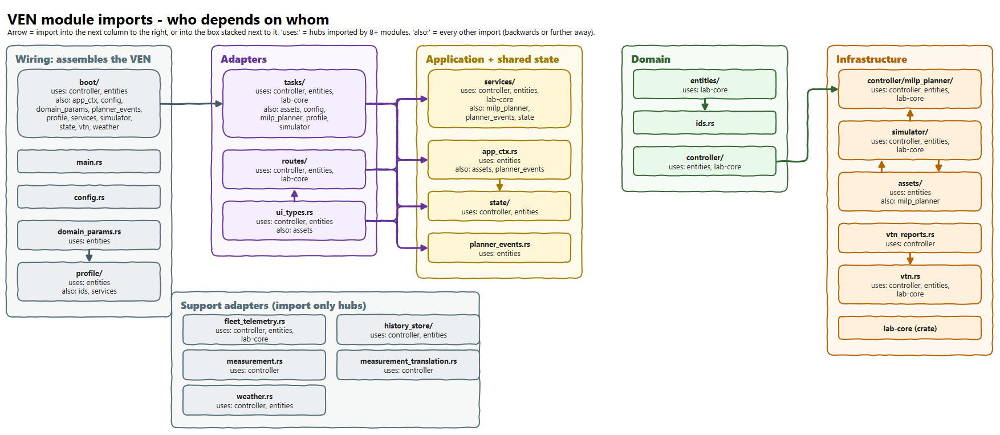

# VEN module import graph — what the code actually depends on

Editable source: [`module_import_graph.drawio`](module_import_graph.drawio). Its companion, the
purpose-level picture of the same crate, is [module_component_diagram.md](module_component_diagram.md).

## 1. Purpose

If you have read the [component diagram](module_component_diagram.md) you know the VEN as a set of
parts with jobs: a front door, a set of use cases, a brain and a real world, with one law that inner
rings never depend on outer ones. That picture is a *design*, drawn by hand. This picture asks a
simple question of the *code*: **is it true?**

It shows what each module actually imports. A design that says "the brain knows nothing about the
outside world" is only true if no arrow in the code points the wrong way, and this is the picture where
you would see it if one did.

The authoritative, always-current version is the generated Mermaid block in
[module_dependency_graph.md](module_dependency_graph.md), written by `scripts/gen_module_graph.py` from the
production code (comments and `#[cfg(test)]` blocks stripped) and kept honest by
`scripts/audit_module_graph.py`. The draw.io picture is a more readable drawing of that data at the
time it was drawn; regenerate the Mermaid section to see the current graph.

## 1a. How this differs from the component diagram

The two pictures show the same crate from two directions. They are meant to be read together, and
neither replaces the other.

| | [Component diagram](module_component_diagram.md) | Module import graph (this page) |
|---|---|---|
| **Question** | What is each part *for* and how does work flow? | What does each module *import* in the code? |
| **Source of truth** | Drawn by hand: it states the intended design. | Derived from `crate::` references in production code: it states the actual dependencies. |
| **Unit** | A responsibility: a service, a loop, a trait, a data group. Several appear inside one module, and traits (ports) are drawn as boxes of their own. | A top-level module of `VEN/src` (`controller/milp_planner/` separately) plus `lab-core`. Types, functions and loops do not appear. |
| **Arrows** | Runtime calls between rings, and "implements" for ports. | Compile-time imports. A call through a port is *not* an arrow to the implementation: the caller imports the trait, and only `boot/` (plus `vtn_reports.rs`, part of the client) imports the adapter. |
| **Detail** | Function names, routes, loops, what each box does. | Only the module names and who imports whom. |
| **Can go wrong by** | Drifting from the code: the hand-drawn picture says one thing, the code does another. | Nothing it does not show: it cannot say *why* an import exists, and it hides calls made through ports. |
| **Used for** | Onboarding, design discussion, explaining why there are so many parts. | Checking the ring rule, finding a wrong-way import, estimating what a change touches. |

Two examples of where they differ on purpose:

* In the component diagram `tasks/` *calls* the VTN through `VtnPort`, and `vtn.rs` *implements* that
  port. In the import graph `tasks/` has no arrow to `vtn.rs` (the audit forbids it); `boot/` imports
  `vtn` because it builds the client.
* The component diagram draws `PlanningService`, `UserRequestService` and `ObligationService` as three
  boxes. The import graph draws one box, `services/`, because the rule is about the module.

Use the component diagram to understand a design, then the import graph to confirm the code still
has that design.

## 2. How to read it

* One **node** per top-level module of `VEN/src` (`controller/milp_planner/` is separate, because the
  ring map puts it in infrastructure), plus the `lab-core` crate.
* Nodes sit in columns that follow the rings, left to right: wiring, adapters, application, domain,
  infrastructure. A block under the first columns holds modules that import only the shared hubs.
* An **arrow** is a `crate::` import in production code. To stay legible, arrows are drawn only
  into the next column on the right or into the box stacked next to it.
* `uses:` names the **hubs**: modules imported by eight or more others (`entities/`, `controller/`,
  `lab-core`). Drawing every arrow to them would cross the whole picture, and the fact that
  "everything depends on the domain" is the intended shape.
* `also:` lists every other import — backwards, or further away than the next column — so nothing is
  dropped from the picture, only moved from an arrow into text.

## 3. The columns

| Column | Modules | Role |
|---|---|---|
| Wiring | `boot/`, `main.rs`, `config.rs`, `domain_params.rs`, `profile/` | Assemble the VEN: read configuration, load the profile, build the typed parameter structs. They are allowed to import widely because they build the rest. |
| Adapters | `tasks/`, `routes/`, `ui_types.rs` | Loops and HTTP handlers. `ui_types.rs` is the generated TypeScript contract for the UI, so it imports the types it describes. |
| Application + shared state | `services/`, `app_ctx.rs`, `state/`, `planner_events.rs` | Use cases, the context handed to routes, and the shared state the planner and routes read. |
| Domain | `entities/`, `ids.rs`, `controller/` | Data and rules. `ids.rs` holds the canonical asset-id constants. |
| Infrastructure | `controller/milp_planner/`, `simulator/`, `assets/`, `vtn_reports.rs`, `vtn.rs`, `lab-core` | The solver, the physics and the VTN client (`vtn_reports.rs` submits reports through it). |
| Support adapters | `fleet_telemetry.rs`, `history_store/`, `measurement.rs`, `measurement_translation.rs`, `weather.rs` | MQTT, SQLite and weather adapters that implement ports. They import only hubs: the domain defines the port, they only fill it. |

## 4. What the shape tells you

* **Hubs on the right of the picture, not on the left.** `entities/` and `controller/` are imported by
  almost everything and import almost nothing (`entities/` imports `ids.rs` and `lab-core`). That is the
  signature of a domain that other code depends on and that depends on nothing around it.
* **Wiring imports many, nothing imports wiring.** `boot/` reaches into most modules because it builds
  them; no domain or infrastructure module imports `boot/`.
* **Support adapters are leaves.** `weather.rs`, `measurement.rs` and `fleet_telemetry.rs` import
  `controller/` (for the port and its types) and `entities/`; nothing in the domain imports them.
* **`simulator/` and `assets/` import each other.** The simulator owns the roster and ticks the assets;
  the assets are the `Asset` implementations the simulator holds. They are one infrastructure unit
  drawn as two boxes.
* **`controller/` and `controller/milp_planner/` import each other.** The planner is physically inside
  `controller/` but ringed as infrastructure; the planner reads the controller's types and the
  controller imports the planner. It must not import `assets/` or `profile`: it reads only what
  assets declare (`AssetMilpContext`).

## 5. Spotting a violation

An arrow that points from a more inner column to a more outer one is a ring violation. The audit
`ci/audits/audit_ven_architecture.py` rejects, among others:

* `entities/` importing `assets/`, `profile`, `crate::vtn` or `crate::simulator`;
* anything in `controller/` importing `assets/` or `simulator/`;
* `services/` or `routes/` importing `SimState` or the simulator directly (they use the ports);
* `routes/` or `tasks/` importing `crate::vtn` (they use `VtnPort`);
* a clock read (`Utc::now()`) anywhere except `routes/`, `tasks/` and `boot/`.

In this picture the first two would show as an arrow from the Domain column into Infrastructure other
than the planner's. If one appears, either the audit has a gap or the picture is stale.

## 6. Keeping it current

The Mermaid section in `module_dependency_graph.md` is regenerated with
`python scripts/gen_module_graph.py` and checked with `--check`. The draw.io drawing is produced from
the same edge data; after a structural change, regenerate both and compare against the table in
section 3.
